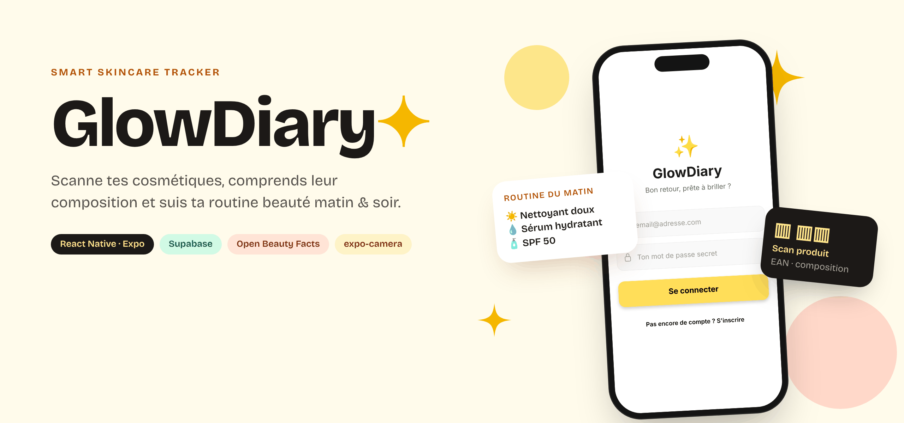

  

# ✨ GlowDiary - Smart Skincare Tracker

Bienvenue dans **GlowDiary**, ton coach de routine beauté personnel ! Ce projet est une application mobile développée avec **React Native** et **Supabase**, inspirée par le concept de Foodvisor, mais appliquée à la skincare et haircare.

## 🚀 Le Projet en une semaine
L'objectif est de créer une application capable de scanner des produits cosmétiques, d'analyser leur composition via une API externe et de suivre l'évolution de ta peau.

### 🛠 Stack Technique
- **Frontend :** React Native (Expo).
- **Backend :** Supabase (PostgreSQL, Auth, RLS).
- **Données :** API Open Beauty Facts.
- **Stockage :** Supabase Storage (pour les photos du journal).

---

## 📋 Plan de bataille (Feuille de route)

### Étape 1 : Infrastructure & Backend ✅
- [x] Initialisation du projet sur Supabase (Région Europe).
- [x] Création des tables SQL (`profiles`, `products`, `routines`).
- [x] Configuration du Row Level Security (RLS) pour la protection des données.

### Étape 2 : Connexion & Scan (En cours 🏗️)
- [ ] Initialisation du projet React Native sur MacBook.
- [ ] Configuration des variables d'environnement (`.env`).
- [ ] Mise en place du module `Scanner.js` avec `expo-camera`.
- [ ] Appel à l'API **Open Beauty Facts** pour récupérer les infos produits.

### Étape 3 : Authentification & Profil
- [ ] Création des écrans Login / Sign-up avec Supabase Auth.
- [ ] Formulaire de profil pour définir le type de peau (`skin_type`).

### Étape 4 : Gestion de la Routine
- [ ] Affichage de la liste des produits scannés.
- [ ] Organisation de la routine par moment de la journée (Matin / Soir).

### Étape 5 : Le Journal de bord (Bonus "Foodvisor style")
- [ ] Upload de photos pour suivre l'évolution de la peau (Supabase Storage).
- [ ] Galerie de photos avec dates.

---

## ⚙️ Installation Locale

1. **Cloner le projet**
2. **Installer les dépendances** : `npm install`
3. **Configurer le `.env`** : Créer un fichier `.env` avec tes clés `EXPO_PUBLIC_SUPABASE_URL` et `EXPO_PUBLIC_SUPABASE_ANON_KEY`.
4. **Lancer l'app** : `npx expo start`

---

## 💡 Notes de dev (Anaïs / Venus)
- **Point fort :** Frontend et intégration API.
- **Challenge de la semaine :** Maîtriser le backend Supabase et la gestion des permissions RLS.